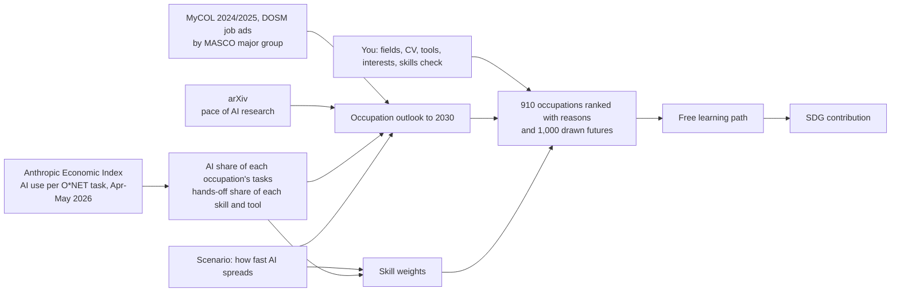

# Future Skills

Future Skills shows people in Malaysia, students and working people in any field, what AI is doing to work and what it means for them. For each of 910 occupations in 22 fields it measures how much of the work people already hand to AI (Anthropic Economic Index, Malaysia next to the world), turns that into rising and declining jobs and skills under a future you pick, ranks every occupation for you with the reasons, and builds a free learning path with the UN goals it serves. Every number carries its source and date, and every occupation an evidence grade that says how much of it is the occupation's own data.

It does not predict one future or say a job will disappear. AI use in a task is not the loss of a job: an occupation is a bundle of tasks, some handed to AI, some done with it, some still a person's. Future Skills shows which is which, how that shifts under the scenario you pick, the occupations that stay open to you, and what to learn first.

**Try it:** [Open in GitHub Codespaces](https://codespaces.new/zhiyang19015-stack/Future-Skills) (starts the app in your browser), or [run it locally](#option-2--run-locally). English, Bahasa Melayu and 中文.

## Overview

### Problem

A school leaver, a graduate or someone already at work in Malaysia has to choose what to learn next while AI changes which tasks still need people, and mostly chooses by guesswork. AI is spreading faster than training: 56% of Malaysian professionals use AI tools at work but only 26% have had formal training (Hays Asia Salary Guide 2025), and MOSTI expects more than 600,000 workers to need reskilling within three to five years. Career tests rarely look at Malaysian demand or at how far AI has already entered each kind of work, and course lists do not say which skills matter for which job. A wrong choice costs months of study for a job the person does not fit or that the market needs less.

### Who it is for

- **First: a working adult whose tasks AI is changing.** The lead demo person is Aiman, a fictional software QA tester whose team now uses AI to write test scripts. He sees his own job's tasks split into those AI already does and those still his, his outlook under each scenario, the adjacent occupations open to him, and a free path ordered by his gaps.
- **Students and career switchers** use the same engine and data (four more fictional people).
- **HR, L&D and career-centre officers** get the Team view: the same engine over a team's jobs and headcounts, shown with a fictional team of 20.

First customers we would approach: university and TVET career centres, which already advise the people above and need no integration to start; enterprise HR comes after a pilot.

### Solution



What is measured and what is assumed are kept apart:

- **Measured** (latest release, with its date): the AI share of each of the 18,592 O*NET tasks, the mean of two readings: Anthropic's own task coverage, and `automation × 1 + augmentation × 0.5` in the latest month for tasks with at least 0.01% of all use. An occupation's AI share is the importance-weighted mean of its tasks; an occupation few people bring to Claude leans on Anthropic's observed exposure for it (or, when that is 0, on its field) and keeps a wider range. A skill's or tool's hands-off share is how often, when AI is used for it, the whole thing is handed over.
- **Malaysian demand** (0–100): MyCOL 2024/2025 status (on the list, close to it, or not) and the change in the occupation's MASCO major group's share of DOSM online job ads, weighted by confidence. Each O*NET occupation reaches MASCO through ISCO-08, using the official ESCO–O*NET crosswalk.
- **Assumed** (one number you choose): how far, by 2030, AI use moves from where the data has it towards everywhere it can be used. Slow 10%, moderate 25%, fast 50%, or any value up to 90% with the slider.
- **Outlook to 2030** = demand + adoption × research tempo × (60 × (share of its tools that build AI − average) − 100 × max(0, AI share − average)) ÷ 100. A share above the average lowers the outlook; a share below it earns nothing, because the Economic Index sees chat-AI use only, not ATMs, robots or self-service machines. It says nothing about total hiring.
- **Skill weight** = 1 + adoption × (1 if it builds AI − 2 × (hands-off share − typical AI use) ÷ 100). A skill AI takes over more than typical counts for less in your skill fit as adoption grows.
- **Match** = 20% field fit + 15% interest + 30% skills + 35% outlook, each part shown. A part you did not answer is left out, never counted as 0.

- **Evidence grade** (A, B or C; `scripts/evidence.py`): three rule-based checks, 0–2 points each: whether the AI share is measured on the occupation's own tasks, how exactly it maps to a MASCO code, and how fresh the AI-usage release and the demand numbers are. It is a grade, not a probability: nothing calibrates it against outcomes. Where there is no reliable source the app says so.
- **Routes kept open** (career option value): of the occupations O*NET lists as related, how many are not declining under the scenario, need no higher qualification, and sit within 15 match points. A count of next moves, not a promise of jobs.

Every constant is our assumption, listed on the app's Sources page and in [SOURCES.md](SOURCES.md). The app never invents jobs, courses or statistics, and the person makes the final decision.

### Key Features

Six steps, plus a Team view and a Sources page:

1. **You** — studying, working, or switching jobs (working people pick the job they do now from all 910); the fields you like; your CV (PDF, .docx or text, read by word matching for one request and never stored: tools, highest qualification, subjects, job titles); the tools you use; a 36-statement interest questionnaire (RIASEC); and a **skills check** where you pick, for each skill, the hardest of O*NET's own examples you can already do ("Write an email to staff outlining new directives"), so your level sits on the same scale as every occupation. Or load one of five fictional people.
2. **Radar** — what AI is already doing to work in every field: Malaysia next to the world, each field's AI share and outlook, the occupations rising and declining most, a search over all 910, and every skill, knowledge area, tool and AI-use topic with its hands-off share. Each occupation's page lists the tasks AI already does and the ones still yours, the signals behind its outlook (MyCOL, DOSM job ads, the median wage of its group), related occupations, and the body to register with if it is a regulated profession in Malaysia.
3. **Matches** — every occupation ranked for you, with the field fit, interest, skills and outlook parts; "Why this score?" with what would raise it; how often it stays in your top 3 across 1,000 drawn futures; your own job's outlook if you work; job-search links (MYFutureJobs, JobStreet, LinkedIn) using the title Malaysians search for; a job-ad reader.
4. **Pathway** — free courses on your own gaps, biggest first, each link opened and checked, with hours and weeks at your study time, progress and a calendar file (.ics); hands-on training in Malaysia (SKM skills certificates, site safety) where a website cannot teach the skill.
5. **SDG** — every occupation and skill linked to UN SDG targets with a written reason; your path's hours added up per target. Pick the goals you care about and see which occupations move up and what that costs in study hours; an anonymous total over everyone who follows a path.
6. **Futures** — your ranking under slow, moderate and fast adoption side by side, and the 1,000 drawn futures. Then **publish a piece of simulated AI news** ("AI scribes now write clinical notes", "AI closes the monthly books", "AI tutors mark homework and plan lessons"): the same pipeline runs on a changed copy of the data and shows the skills, occupations, your ranking and your path before and after. Or change one number yourself: a MASCO group's job ads, a MyCOL status, a topic's hands-off share, the AI share of a work activity.

**Team** (for HR and career centres) — a team as job titles and headcounts, never names. For each job: the AI share of its tasks, its outlook under all three scenarios and its evidence grade. For each job declining under the scenario: the best-matching adjacent occupation that is not declining, with its free courses; where none qualifies the page says so and points at the tasks that stay with people. Then a skill-gap heatmap, who to train together, person-hours and course fees, and the UN targets served. The demo team is fictional.

Everywhere: light and dark, built for a phone and slow mobile data (no images, no web fonts, gzip and ETags), no login, and your answers stay in your browser.

## Tech Stack

| Layer | Technology |
|---|---|
| Frontend | HTML, CSS and plain JavaScript (`src/static/`), no build step; PDF.js (reads PDF CVs in the browser), loaded from a CDN when first needed |
| Backend | Python 3.10+ standard library only (`http.server` JSON API in `src/main.py`); nothing to install |
| Data | CSV and JSON tables in `data/`, rebuilt by the scripts in `scripts/` and checked by `scripts/validate_data.py` |
| Hosting | GitHub Codespaces (`.devcontainer/`), or any machine with Python 3.10+ |

## Project Structure

```
.
├── data/                          # Every table the app reads; every row keeps its source and date
│   ├── fields.csv                 # The 22 fields (SOC major groups), named in three languages
│   ├── occupations.csv            # 910 O*NET occupations: field, Job Zone, RIASEC, ISCO/MASCO, MyCOL
│   ├── elements.csv               # 35 skills and 33 knowledge areas with O*NET's level examples
│   ├── occupation_elements.csv, technologies.csv, occupation_technologies.csv
│   ├── occupation_titles.csv, related_occupations.csv
│   ├── mycol_map.csv              # The MyCOL 2024/2025 list with its ISCO-08 codes
│   ├── demand_inputs.csv, demand.csv            # DOSM job ads, OpenDOSM wages, arXiv; demand per occupation
│   ├── aei/                       # Anthropic Economic Index extract (generated)
│   ├── onet/                      # O*NET tasks and skill-to-work-activity links (generated)
│   ├── ai_occupations.csv, ai_tasks.csv, ai_skills.csv, ai_topics.csv   # the AI layer as tables (generated)
│   ├── skill_topic_map.csv        # Our crosswalk: tool -> AI-use topic, with a reason
│   ├── sdg_map.csv                # Our SDG links, each with a reason
│   ├── learning_resources.csv     # Free courses and programmes, each link checked
│   ├── regulated.csv              # Malaysian bodies a regulated profession registers with
│   ├── interest_items.json        # The 36 interest statements
│   ├── sample_profiles.json       # Five fictional people
│   └── sample_team.json           # A fictional team of 20: job titles and headcounts
├── raw/                           # The DOSM workbook and the typed MyCOL list (other downloads stay out of git)
├── scripts/
│   ├── build_onet.py              # O*NET 31.0 + ESCO crosswalk -> the occupation tables
│   ├── build_topic_map.py, build_sdg_map.py
│   ├── ai_exposure_extract.py     # Economic Index release -> data/aei/
│   ├── ai_exposure.py             # AI share per task and occupation, hands-off share per skill and tool
│   ├── demand.py                  # "Update data": DOSM, OpenDOSM, arXiv -> Malaysian demand
│   ├── outlook.py                 # Scenarios: outlook, skill weights, 1,000 drawn futures
│   ├── matching.py                # Field fit and the explained score of every occupation
│   ├── skillcheck.py, interest.py, cv_reader.py, explain.py, learning.py, impact.py
│   ├── evidence.py                # Evidence grade of every occupation's numbers (A, B, C)
│   ├── team.py                    # The team view: the same matching over a team's jobs
│   ├── scenario_report.py         # What the scenarios change for each demo person, and why
│   ├── whatif.py                  # Simulated AI news and changed numbers, run on a copy
│   ├── releases.py                # Reports a newer Economic Index release
│   └── validate_data.py, check_links.py, fairness_check.py
├── src/
│   ├── main.py                    # Web server and JSON API (entry point)
│   └── static/                    # index.html, style.css, app.js, you.js, explore.js, futures.js,
│                                  # team.js, i18n.js and quiz-i18n.js (languages), sample_cv.txt
├── tests/
├── docs/scenario_report.md       # Generated by scripts/scenario_report.py
├── .devcontainer/                 # GitHub Codespaces set-up (starts the app on port 5000)
├── .env.example
├── LICENSE
└── SOURCES.md                     # Every source, its licence, and the model's choices and limits
```

## How to Run

### Option 1 — GitHub Codespaces

[](https://codespaces.new/zhiyang19015-stack/Future-Skills)

1. Click **Code → Codespaces → Create codespace on main** (or the button above).
2. The codespace runs `python src/main.py` on port 5000 and opens the app. Nothing is installed. If the tab does not open, open port 5000 from the **Ports** tab.
3. Optional: to let a language model word the "Why this score?" text, add the variables from `.env.example` as Codespaces secrets.

### Option 2 — Run locally

```bash
git clone https://github.com/zhiyang19015-stack/Future-Skills.git
cd Future-Skills
python src/main.py              # then open http://localhost:8080 (PORT=5000 changes it)
```

### Rebuild the data (maintainers)

The large downloads stay out of git (see [SOURCES.md](SOURCES.md) for every URL). With them in one folder:

```bash
python scripts/build_onet.py --raw D:/future-skills-raw          # O*NET 31.0 + ESCO -> occupations
python scripts/build_topic_map.py
python scripts/build_sdg_map.py
python scripts/ai_exposure_extract.py --raw D:/future-skills-raw # the pinned Economic Index release
python scripts/ai_exposure.py
python scripts/demand.py                                         # also what "Update data" runs
python scripts/validate_data.py
```

### API

All JSON; `GET /api` lists every endpoint.

| Method | Endpoint | Returns |
|---|---|---|
| GET | `/api/fields`, `/api/occupations`, `/api/technologies`, `/api/elements` | The 22 fields, the 910 occupations, the tools, the skills and knowledge areas |
| GET | `/api/occupations/<occ_id>?scenario=` | One occupation: tasks with their AI share, outlook under each scenario, demand signals, skills, tools, SDG targets, licence, related occupations |
| GET | `/api/skillcheck?fields=29,31` | The skills check: the skills those fields need most, each with O*NET's level examples |
| GET / POST | `/api/questionnaire`, `/api/questionnaire/score` | The 36 interest statements / 36 answers (1–5) → RIASEC code |
| POST | `/api/cv/summary` | `{"text"}` or `{"docx_base64"}` → tools, qualifications, subjects, job titles, field evidence. Not stored |
| GET | `/api/radar?scenario=` | Every field and occupation's outlook, the rising and declining ones, every skill, tool and topic |
| POST | `/api/match` | A profile → field fit and the ranked occupations with every part, skills gap, outlook and stability |
| POST | `/api/explain` | Same body plus `occ_id` and `lang` (en, ms, zh) → why this score, and what would raise it |
| POST / GET | `/api/learn`, `/api/learn/<occ_id>` | The learning path on the person's gaps / the occupation's own list |
| POST | `/api/jobad` | A job ad's text → the tools it asks for, which you have and miss |
| POST | `/api/futures` | The three scenarios side by side |
| GET / POST | `/api/whatif` | What can be changed and the simulated news / run one on a copy, before and after |
| GET / POST | `/api/sdg/summary`, `/api/sdg/record` | The anonymous SDG total / one browser's path hours |
| GET / POST | `/api/team?scenario=` | The fictional team, or your own `{"members": [{"occ_id", "headcount"}], "hours_per_week"}`: jobs, moves, skill-gap heatmap, training groups, hours, SDG targets. Not stored |
| GET | `/api/sources`, `/api/scenarios`, `/api/explain/status`, `/api/health` | Sources and constants, scenarios, whether an LLM is set up |
| GET / POST | `/api/update` | Status of / start "Update data" |

A profile has any of `kind`, `education_job_zone` (1–5), `current_occupation`, `fields` ({field_id: 0–100}), `interest_answers` (36 numbers), `skills` and `cv_skills` ({element_id: 0–7}), `technologies`, `cv_fields`, `hours_per_week` and `sdg_goals`, or `profile_id` for a demo person; plus `scenario` (`slow`, `moderate`, `fast`) or `adoption` (0–0.9), and `trend_changes` to build the result from a changed copy of the data for that request only.

### Check the data and run the tests

```bash
python scripts/validate_data.py
python -m pytest -q               # or: python -m unittest discover tests
python scripts/check_links.py     # needs internet: every course and professional body link still opens
python scripts/fairness_check.py  # the same CV as 8 different people gives the same recommendations
python scripts/scenario_report.py # what slow, moderate and fast adoption change for each demo person, and why
```

The scenario report ([docs/scenario_report.md](docs/scenario_report.md)) is a regression check, not a target: it states how many demo people's top 3 change between slow and fast adoption, by how much each part moved, and why the others did not change. No ranking is required to flip, and the model is not tuned to make one flip.

## Data Rules

- Run `python scripts/validate_data.py` before committing a data change; do not commit if it fails.
- Every row keeps `source_name`, `source_url` and `source_date` (YYYY-MM-DD), or its table's source is in `data/aei/source.json`.
- Malaysian demand comes from DOSM and MyCOL only; O*NET (US) gives the structure of the work, never Malaysian numbers.
- A link that cannot be checked is not shown as checked. Fictional people only: no real CVs or personal data.

## Responsible Use

- **What it is for:** exploring careers and planning training. It makes no hiring, firing or promotion decision and is not built to support one; the person, or the officer with the person, decides.
- **Data kept:** none about a person on the server. Answers stay in the browser's local storage and are removed with "Clear my answers". A CV is read for one request and not stored; a PDF is read in the browser. A team is job titles and headcounts, used for one request. The only thing saved is the anonymous SDG total: a random browser id, an occupation id and hours.
- **Data not asked for:** name, IC number, age, gender, ethnicity, religion, address. The matching has no input for them, and `scripts/fairness_check.py` shows the same CV gives the same recommendations when they appear in it. It tests what a CV's wording can leak, not every source of bias: the O*NET, MyCOL and usage data can carry their own.
- **Before real use under the PDPA 2010:** a hosted deployment would need a privacy notice, HTTPS, access control for the Team view, and a retention period for server logs. This prototype has none of these because it stores no personal data and the demo uses fictional people only.
- **Estimates:** every outlook is read under a named scenario to 2030 with its range and evidence grade. Two months of AI-usage data cannot be back-tested, so the outlook is exploratory, not a validated forecast.

## AI Disclosure

- **In the app:** optionally, an OpenAI-compatible language model words the "Why this score?" text (`scripts/explain.py`). It receives one match's computed facts and nothing about the person; a reply with a number that is not in those facts, a prediction of its own or the wrong language is thrown away and a template is shown. Without a key the template is always used. CVs are read by word matching, not by AI. Every score, outlook, gap and path is computed by our own code from sourced data.
- **In development:** Claude Code (Anthropic) was used to write and test code, check data and links, and draft documentation.

## Limits

- AI usage is one company's product (Claude), mapped to US (O*NET) task descriptions: it shows where AI is entering work, not Malaysian jobs lost. Robots and machines are not in it, so manual work shows little AI use.
- Malaysian demand has few signals: one MyCOL edition, and DOSM job ads by major occupation group only. Two months of AI-usage data is not a trend.
- Occupation titles and descriptions are O*NET's English; the interface is translated.
- The skills check is a self-rating.

## History

Future Skills began as a 2026 hackathon entry that covered 25 IT roles. This version is a rewrite that covers every occupation.

## License

[Apache License 2.0](LICENSE). Data licences are listed in [SOURCES.md](SOURCES.md).
